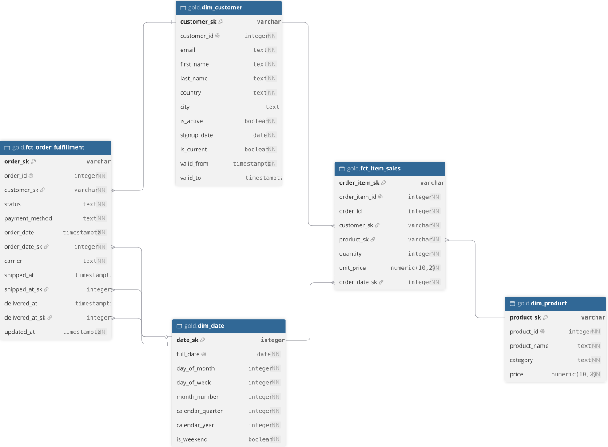

# ADR 0005: Gold layer dimensional modelling

## Status

Accepted

## Context

The gold layer must present the data in a way that answers the questions defined in [`docs/business-context.md`](docs/business-context.md) while making the data easy to understand and query. 

## Decision

To structure the data in a way that is easy to understand and query, the data will be modelled dimensionally using a star schema, with facts representing measurable business processes or events and dimensions representing the context surrounding a fact.

The operations stakeholder group is interested in monitoring order activity and shipment progress. Based on these requirements, a business process to model was identified: order fulfillment, where the grain of the accumulating snapshot fact table is one row per placed order. To describe order fulfillment, two dimensions were identified: date(one date key for each milestone) and customer. The identified milestones were: an order is placed, an order is shipped, and an order is delivered. As order fulfillment progress occurs, the table is updated. 

Another business need identified by the finance stakeholder group was the ability to create revenue reports and perform product performance analysis. The business process to be modelled was sales transactions, where the grain of the fact table is one row per order item. An order item represents a distinct product within an order, its quantity, and its unit price. The identified dimensions were date, product, and customer. The identified facts were order item quantity and order item unit price.

### Late-arriving dimensions

Since orders and order items are ingested every 5 minutes, while customers and products are ingested every 6 hours, dimensions may arrive later than the facts they are associated with.

The fact tables must still be materialized without waiting for the corresponding dimensions to arrive. To accommodate this, a special dimension row containing generic unknown values is created and used when the corresponding dimension record is unavailable.

When the dimensions become available, the fact tables are materialized again, allowing the foreign keys to reference the corresponding dimension records instead of the unknown dimension members.

## Consequences

**Positive**

- The dimensional model provides a structure that is easy to understand and query. Separating facts and dimensions allows business processes to be analysed across different dimensions.

- Full table refreshes are simpler to implement and automatically resolve late-arriving dimensions.

**Negative**

- The dimensional model introduces some data redundancy compared to a normalized relational model.
- Full table refreshes get more expensive as the volume of data in the silver layer grows. This can be later mitigated with incremental processing.

## Alternatives considered

**Third normal form (3NF)**

A normalized relational model was considered as an alternative. However, this approach is primarily suited for operational workloads and would require additional joins to answer analytical queries. A dimensional model was therefore selected as it better supports the business requirements.